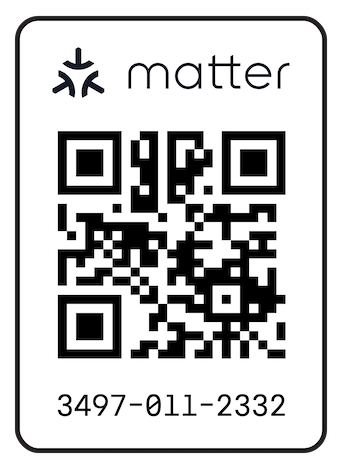

# Matter Over Thread End Sleepy Device With BLE Commissioning

Implements a motion sensor with a Nordic nRF52840 or nRF54L15 MCU and a Bosch BMA400 IMU - be notified when the mailman delivers your mail by attaching an accelerometer to the mailbox lid. This code puts together all the bits that seem to be required for a Matter over Thread End Sleepy Device (ESD) with BLE commissioning.

## Power Consumption

Average standby power consumption for both XIAO nRF boards and a BMA400 is measured at approximately 11µA at 4V from the battery. That's an impressive result.

In addition, the XIAO nRF54L15 appears to consume about 30% less power when reporting an event.

## Requirements

* A custom PCB based on the BMA400 and the [XIAO nRF52840](hw/board-nRF52840/) or [XIAO nRF54L15](hw/board-nRF54L15/).
* A LiPo battery with a JST PH 2.0 connector.

Alternatively, you can cobble together your own setup.

## Downloading and Installing the Firmware

Download and unzip the latest released [firmware.zip](https://github.com/retsyx/nrf-matter-thread-ble-esd/releases/latest/download/firmware.zip). It contains firmware for both boards; use the file matching your MCU.


### Installing on the nRF52840

Connect the board by USB and double press its reset button to enter bootloader mode and expose a mountable drive. Copy `nrf52840.uf2` onto the drive. The firmware will immediately start when the copy completes.

### Installing on the nRF54L15

The XIAO nRF54L15 has a built-in CMSIS-DAP debugger accessible over USB. Use [pyOCD](https://pyocd.io/docs/installing.html) 0.42 or newer to program the released `nrf54l15.hex`; no external debugger or Nordic SDK is needed.

Install pyOCD in a Python virtual environment (macOS/Linux commands):

```sh
python3 -m venv .venv-pyocd
source .venv-pyocd/bin/activate
python -m pip install --upgrade 'pyocd>=0.42'
```

On Windows, create the environment with `py -3 -m venv .venv-pyocd`, activate it with `.venv-pyocd\Scripts\Activate.ps1` in PowerShell, then run the same pip command.

On Linux, also install pyOCD's [USB udev rules](https://pyocd.io/docs/installing.html#udev-rules-on-linux) to allow access to the debugger.

Connect the board with a USB data cable. From the directory containing the extracted firmware, run:

```sh
python -m pyocd list
python -m pyocd load --target nrf54l --erase sector -O auto_unlock=false nrf54l15.hex
```

`nrf54l` is pyOCD's built-in target name for the nRF54L15; no device pack is required. If multiple probes are connected, add `--uid PROBE_ID` to the load command, using the XIAO's unique ID from `pyocd list`.

The board resets and starts the firmware after programming. Sector erase updates the application while preserving this firmware's Matter/OpenThread settings; `auto_unlock=false` prevents an automatic full-chip erase if the target is locked. Disconnect USB and power-cycle the board before measuring battery consumption.

## Building

### Dependencies

Nordic's nRF Connect SDK must be installed with Matter support.

```sh
nrfutil install sdk-manager
nrfutil sdk-manager install v3.4.1
```

Start the Nordic shell:

```sh
nrfutil sdk-manager toolchain launch --ncs-version v3.4.1 --shell
```

Use the Nordic SDK's `west` tool to install the Matter ZAP tool:

`west zap-install`

### Build

Start the Nordic shell:

```sh
nrfutil sdk-manager toolchain launch --ncs-version v3.4.1 --shell
```

Then run from this directory:

For nRF52840:

```sh
python3 scripts/build.py --board nrf52840 --zap /path/to/zap-cli
```

For nRF54L15:

```sh
python3 scripts/build.py --board nrf54l15 --zap /path/to/zap-cli
```

Alternatively, set `ZAP_CLI` to the executable path or make `zap-cli` available
on `PATH`; then omit `--zap`. An explicit `--zap` takes precedence over `ZAP_CLI`,
which takes precedence over `PATH` discovery.

Use the `--pristine` flag for a clean rebuild, including the first build after
replacing an older SDK. The scripts require NCS 3.4.1 and its matching toolchain.

It is possible to specify all the paths to the script, for example:

```sh
python3 scripts/build.py --board nrf52840 --pristine --sdk /path/to/ncs/v3.4.1 --toolchain /path/to/nordic-toolchain --zap /path/to/zap-cli
```

Alternatively, the environment variables
`NCS_SDK_ROOT` and `NCS_TOOLCHAIN_ROOT` can be used.


### Additional Build Parameters

* `--console` enables the UART shell and Thread CLI for diagnostics.
* `--battery` explicitly declares that a rechargeable LiPo is fitted; otherwise battery voltage/percentage remain unknown, even if USB produces charger voltage.

### CI and Releases

GitHub Actions runs the driver tests and builds both MCU variants on every branch push and pull request, or when started manually. Builds use the default profile with USB and console disabled. Download each board's firmware from the workflow run's artifacts.

Pushing a `v*` tag builds both variants and publishes a GitHub release with `firmware.zip` and a `SHA256SUMS` file for the archive. The ZIP includes HEX/ELF files for both boards, the nRF52840 UF2, installation instructions, version/build information, and checksums. Tags containing a hyphen, such as `v1.1.0-rc.1`, create prereleases. Update `VERSION` before tagging when changing the firmware version.

## Matter Commissioning

An uncommissioned boot opens BLE commissioning for 15 minutes. Add the accessory using a Matter controller and Thread border router.

With your favorite Matter commissioner (HomeKit, etc.) add the accessory.

This project uses development commissioning credentials, so the QR code is always the one below.



Commissioning values use the defaults:

| Development credential | Value |
| --- | --- |
| Manual code | `34970112332` |
| QR payload | `MT:4CT9142C00KA0648G00` |
| Setup passcode | `20202021` |
| Discriminator | `3840` / `0xF00` |
| Vendor / product | `0xFFF1` / `0x8004` |

